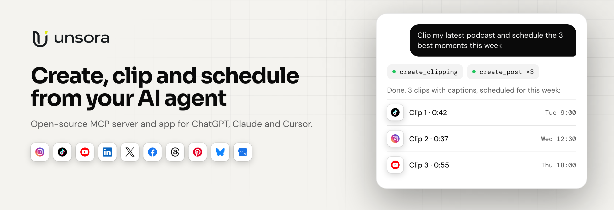

<p align="center">
  <a href="https://tryunsora.com">
    <picture>
      <source media="(prefers-color-scheme: dark)" srcset=".github/assets/banner-dark.png">
      
    </picture>
  </a>
</p>

<p align="center">
  <a href="LICENSE"></a>
  <a href="https://modelcontextprotocol.io"></a>
  <a href="https://github.com/Shipped-Studio/unsora/stargazers"></a>
  <a href="https://github.com/Shipped-Studio/unsora/actions/workflows/ci.yml"></a>
</p>

<p align="center">
  <a href="https://tryunsora.com"><b>Website</b></a> ·
  <a href="https://docs.tryunsora.com"><b>Docs</b></a> ·
  <a href="#connect-your-agent"><b>Connect your agent</b></a>
</p>

# Unsora

AI content generation and social scheduling. Generate images, video, voiceovers, music and clips, then schedule and publish them to connected social accounts, from the web app, the public API, or any MCP client.

<table>
  <tr>
    <td width="25%" valign="top">
      <br>
      <b>Create</b><br>
      Images, video, voiceovers and music from leading AI models.
    </td>
    <td width="25%" valign="top">
      <br>
      <b>Clip</b><br>
      Turn long videos into captioned shorts, ready to post.
    </td>
    <td width="25%" valign="top">
      <br>
      <b>Schedule</b><br>
      Plan and publish to Instagram, TikTok, YouTube, LinkedIn, X, Facebook, Threads, Pinterest, Bluesky and Google Business Profile.
    </td>
    <td width="25%" valign="top">
      <br>
      <b>Connect</b><br>
      Do it all from ChatGPT, Claude, Cursor or any MCP client, or through the REST API.
    </td>
  </tr>
</table>

## Connect your agent

Add Unsora as a remote MCP server and sign in when your client asks:

```
https://mcp.tryunsora.com/mcp
```

Setup guides for each client are in the [docs](https://docs.tryunsora.com).

## Repository layout

A [pnpm](https://pnpm.io) workspace orchestrated with [Turborepo](https://turborepo.com).

| Path | Package | What it is | Runs on |
| --- | --- | --- | --- |
| [`apps/client`](apps/client) | `@unsora/client` | Next.js web app | Vercel |
| [`apps/server`](apps/server) | `@unsora/server` | Express API (app routes + public `/api/v1`), Prisma/Postgres, Trigger.dev background tasks in `src/queue` | Railway (API) + Trigger.dev (tasks) |
| [`apps/mcp`](apps/mcp) | `@unsora/mcp` | Remote MCP server that exposes the public API as tools, with OAuth via Clerk or API-key auth | Railway |
| [`apps/remotion`](apps/remotion) | `@unsora/remotion` | Remotion compositions (subtitle rendering) used by the server through Remotion Lambda | AWS Lambda |

Shared code goes in `packages/*` (none yet).

The Mintlify docs and API reference for docs.tryunsora.com live in a separate repo, [Shipped-Studio/docs.tryunsora.com](https://github.com/Shipped-Studio/docs.tryunsora.com). Its `openapi.json` is generated from this repo: edit `apps/server/src/docs/openapi.ts`, then run `pnpm --filter @unsora/server docs:export-openapi` with the docs repo cloned next to this one (or `DOCS_DIR` pointing at it), and commit the result in the docs repo.

```
client ──► server /api ──► Postgres, Supabase storage, AI providers
                │
                ├──► Trigger.dev tasks (apps/server/src/queue)
                └──► Remotion Lambda (apps/remotion)
mcp ─────► server /api/v1
```

## Local development

Requires Node 20 (see `.node-version`), pnpm 10 (`corepack enable` picks the pinned version) and a Postgres database.

```bash
pnpm install          # also generates the Prisma client

# one-time per app: copy the example env and fill it in
cp apps/server/.env.example apps/server/.env
cp apps/client/.env.example apps/client/.env
cp apps/mcp/.env.example apps/mcp/.env

pnpm dev:server       # API on :8000
pnpm dev:trigger      # Trigger.dev dev worker for background tasks
pnpm dev:client       # web app on :3000
pnpm dev:mcp          # MCP server on :3002
```

Other tasks run through Turborepo across every app: `pnpm build`, `pnpm typecheck`, `pnpm lint`. Add `--filter=@unsora/<app>` to target one.

Database migrations live in `apps/server/prisma`. Run them with `pnpm --filter @unsora/server migrate`.

## Deployment

- **client**: Vercel project with Root Directory `apps/client`. `apps/client/vercel.json` uses `turbo-ignore` to skip builds when nothing the client depends on changed.
- **server**, **mcp**: Railway services that build from the repository root with Config File Path `/apps/server/railway.json` and `/apps/mcp/railway.json`. Each config sets the Turborepo build command, the start command and watch paths, so a service only redeploys when its app or the workspace config changes.
- **Background tasks**: run the *Deploy Trigger.dev tasks* workflow (or `pnpm dlx trigger.dev deploy` from `apps/server`) after the API deploy that a task change depends on.
- **remotion**: deploy the site with `npx remotion lambda sites create src/index.ts --site-name=<name>` from `apps/remotion`, then set `REMOTION_SERVE_URL` on the server.
- **docs**: Mintlify deploys from the [docs repo](https://github.com/Shipped-Studio/docs.tryunsora.com) on every push to its `main`. Preview locally with `npx mint dev` from that repo.

Deploy the server before the MCP server when new MCP tools call new API endpoints.

## CI

`.github/workflows/ci.yml` installs the workspace and runs `turbo run typecheck --affected` plus the server and MCP builds, so only apps touched by a change are checked.

## License

[AGPL-3.0](LICENSE)
